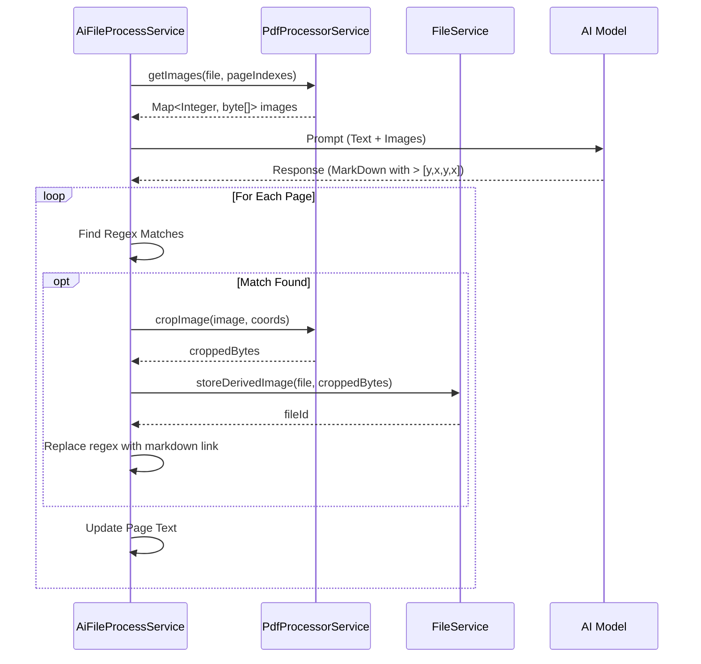

# Auto-Crop and Replace Implementation Plan

## 1. Overview
The goal is to process the AI response from the PDF extraction step. The AI identifies visual elements and returns their bounding box coordinates in the format `> [ymin, xmin, ymax, xmax]`. We need to parse this, crop the original page image, save the crop as a new file, and replace the coordinate line with an image link in the final Markdown output.

## 2. Component Changes

### A. `PdfProcessorService.java`
**New Method:** `cropImage`
-   **Input:** `byte[] imageBytes`, `int ymin`, `int xmin`, `int ymax`, `int xmax`
-   **Logic:**
    1.  Read `imageBytes` into `BufferedImage`.
    2.  Get width `W` and height `H`.
    3.  Convert normalized coordinates (0-1000) to pixel coordinates:
        -   `y = ymin * H / 1000`
        -   `x = xmin * W / 1000`
        -   `h = (ymax - ymin) * H / 1000`
        -   `w = (xmax - xmin) * W / 1000`
    4.  Validate bounds (clamp to image dimensions).
    5.  `img.getSubimage(x, y, w, h)`.
    6.  Write back to `byte[]` (PNG format).
-   **Output:** `byte[] croppedImage`

**Modification:**
-   Update `convertToMedias` or add a new method `getImagesForPages` to return `Map<Integer, byte[]>` (Page Index -> Image Bytes) to avoid re-rendering multiple times and to allow access to raw bytes for cropping.

### B. `FileService.java`
**New Method:** `storeDerivedImage`
-   **Input:** `DbFile originalFile`, `String fileName`, `byte[] content`
-   **Logic:**
    -   Use `createOrUpdateDerivedFile` logic but maybe enforce specific naming pattern or content type (image/png).
    -   Return `FileDTO` (we need the ID for the link).

### C. `AiFileProcessService.java`
**Modification:** `processBatch`
-   **Current Flow:**
    1.  Gather text and images for batch.
    2.  Call AI.
    3.  Split response by `---`.
    4.  Assign text to pages.
-   **New Flow:**
    1.  Determine `mediaIndexes` (pages needing vision).
    2.  Fetch images: `Map<Integer, byte[]> pageImages = pdfProcessorService.getImages(file, mediaIndexes)`.
    3.  Construct prompt using these images.
    4.  Call AI.
    5.  Split response by `---`.
    6.  **Loop through page parts:**
        -   For each part (corresponding to `pageIndex`), check for Bounding Box Regex: `>\s*\[\s*(\d+)\s*,\s*(\d+)\s*,\s*(\d+)\s*,\s*(\d+)\s*\]`
        -   **If Match Found:**
            -   Get `originalImage` from `pageImages.get(pageIndex)`.
            -   Parse coordinates.
            -   `croppedBytes = pdfProcessorService.cropImage(originalImage, ...)`
            -   `fileName = "crop_" + pageIndex + "_" + timestamp + ".png"`
            -   `savedFile = fileService.storeDerivedImage(file, fileName, croppedBytes)`
            -   `replacement = " + "/view)"`
            -   Replace the matched line with `replacement`.
    7.  Assign processed text to `page.setText(...)`.

## 3. Data Flow Diagram

## 4. Regex Detail
Regex: `(?m)^>\s*\[\s*(\d{1,4})\s*,\s*(\d{1,4})\s*,\s*(\d{1,4})\s*,\s*(\d{1,4})\s*\]`
- `(?m)`: Multiline mode to match start of line `^`.
- `^>\s*`: Starts with `>` and optional space.
- `\[...\]`: The brackets.
- `(\d{1,4})`: The coordinates (0-1000).

## 5. Next Steps
1.  Add `getImages` and `cropImage` to `PdfProcessorService`.
2.  Add `storeDerivedImage` to `FileService` (or use existing).
3.  Update `AiFileProcessService` logic.
