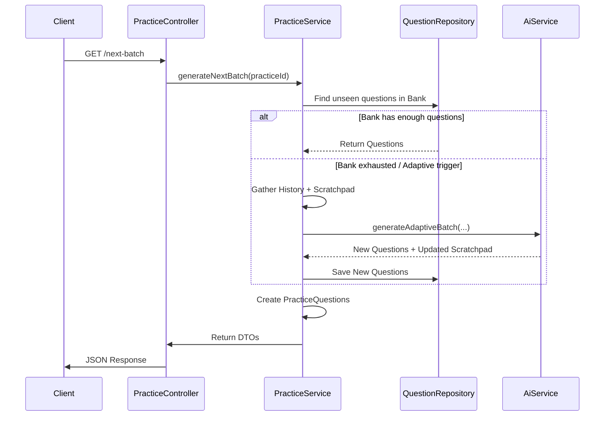

# Endless Practice Mode Architecture Plan

## 1. Overview
The "Endless Practice" feature allows users to enter a practice session that does not have a fixed limit. The system will dynamically serve questions, prioritizing unseen questions from the bank and generating new ones using AI when the bank is exhausted or to provide specific adaptive reinforcement. A "Scratchpad" mechanism will allow the AI to maintain a persistent context of the user's specific learning state during the session.

## 2. Entity Schema Changes

### `Practice` Entity
We need to track if a practice is endless and store the AI's internal state.

```java
// src/main/java/com/quizspark/quizsparkserver/models/Practice.java

public class Practice {
    // ... existing fields ...

    @Column(nullable = false)
    private boolean endlessMode = false;

    @Column(columnDefinition = "TEXT")
    private String aiScratchPad; // Stores JSON or Text summary of student state

    // ...
}
```

## 3. AI Service & Prompt Engineering

We need a separate prompt strategy for the "Endless Loop". This prompt differs from the bulk generation prompt because it is iterative and context-aware.

### Prompt Variables
*   **Student History (Recent):** Last 5-10 questions, user answers, correctness, and time taken.
*   **Current Scratchpad:** The AI's previous notes on the student (e.g., "Student struggles with X").
*   **Target Domain:** The tags/topics of the Question Bank.

### Prompt Structure (Draft)

```text
### Role
You are an Adaptive Tutor. Your goal is to guide a student through an endless practice session on [TOPICS].

### Context (The Scratchpad)
Here is your previous assessment of this student's state:
"{{CURRENT_SCRATCHPAD}}"

### Recent Performance
The student just answered the following:
1. Question: "..." | Result: CORRECT | Time: 5s
2. Question: "..." | Result: INCORRECT (Ans: A, User: B) | Time: 45s
...

### Task
1. **Analyze**: Update your understanding of the student's mastery. detecting patterns in their errors.
2. **Generate**: Create {{BATCH_SIZE}} new questions.
    - If struggling: Reinforce concepts, simplify slightly, focus on error correction.
    - If cruising: Increase difficulty, introduce edge cases, combine concepts.
3. **Update Scratchpad**: Write a new concise summary for yourself for the next turn.

### Output Format (JSON)
{
  "newScratchpad": "Student understood X but failed Y...",
  "questions": [
    { ... QuestionDTO structure ... }
  ]
}
```

## 4. Logic Flow: `fetchNextQuestions`

This logic will be implemented in `PracticeService`.

### Triggers
*   **Initial Start:** If `endlessMode` is true, start with a standard batch (e.g., 5 questions).
*   **Client Request:** Client detects it is running low on questions (e.g., < 2 remaining) and calls `GET /api/v1/practice/{id}/next-batch`.

### Algorithm
1.  **Load Context:**
    *   Load `Practice` entity.
    *   Load `QuestionBank`.
    *   Identify all `baseQuestion` IDs already used in this practice (`Set<UUID> usedQuestionIds`).

2.  **Check Bank for Unseen Content (Layer 1):**
    *   Query `QuestionBank` for questions WHERE id NOT IN `usedQuestionIds`.
    *   Select up to `BATCH_SIZE` (e.g., 5).
    *   *Optimization:* If `aiScratchPad` indicates specific weak tags, prioritize unseen questions with those tags.

3.  **Adaptive AI Generation (Layer 2 - Infinite):**
    *   If (Found Questions < BATCH_SIZE):
        *   Calculate `needed = BATCH_SIZE - found`.
        *   Fetch last 10 `PracticeQuestion`s (to build history context).
        *   Call `AiService.generateAdaptiveBatch(history, currentScratchPad, needed, tags)`.
        *   **Persist Generated Content:**
            *   Create new `Question` entities for the generated content.
            *   Save them to the `QuestionBank` (growing the bank).
            *   Mark them as `AI_GENERATED` in tags.
    *   Combine `Found` + `Generated` questions.

4.  **Update State:**
    *   Create `PracticeQuestion` entities for the new batch.
    *   Append to `Practice`.
    *   Update `Practice.aiScratchPad` with the new value from AI.
    *   Save `Practice`.

5.  **Return:**
    *   Return list of `PracticeQuestionDTO` for the new batch.

## 5. Implementation Steps

1.  **Database Migration (or Schema Update):** Add `endlessMode` and `aiScratchPad` to `Practice`.
2.  **API Update:**
    *   Update `PracticeCreationDTO` to accept `endlessMode` flag.
    *   Create `PracticeController.getNextBatch(practiceId)`.
3.  **Service Implementation:**
    *   Implement `PracticeService.getNextBatch`.
    *   Implement `PracticeService.findUnseenQuestions`.
4.  **AI Service Implementation:**
    *   Implement `AiFileProcessService.generateAdaptiveBatch`.
    *   Integrate the new Prompt.

## 6. Diagrams


